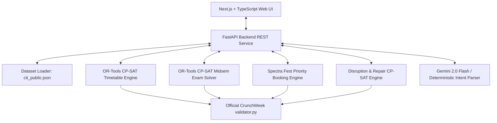

# CIT Campus Management & Timetable Scheduling System

A constraint-based university campus scheduling, examination allocation, event booking, timetable disruption repair, and AI copilot platform for the **Cambridge Institute of Technology (CIT)**.

Built with **Next.js 15 (React 19 + TypeScript + Tailwind CSS)** on the frontend, **FastAPI + Python** on the backend, and powered by **Google OR-Tools CP-SAT** for mathematical constraint programming, validated against the official CrunchWeek benchmark suite.

---

## 🏛️ System Architecture



---

## 📦 Milestones Implemented

### Milestone 01 — Dataset Loader & REST Service
- Dynamically loads and validates `cit_public.json` without modifying the original dataset.
- Robust error handling for schema anomalies, missing keys, and invalid types.
- REST endpoints for dataset summary, rooms, faculty, student groups, courses, sessions, exams, and bookings.

### Milestone 02 — Regular Academic Timetable Generator
- Mathematical constraint programming using **Google OR-Tools CP-SAT**.
- Solves all **189 academic sessions** across 6 days (MON–SAT) and 9 daily periods (P1–P9).
- Enforces all **Hard Constraints (H1–H14)**:
  - Zero faculty clashes, student group clashes, and room double-bookings.
  - Strict lab room assignments for practical sessions.
  - Student lunch break windows (P5–P6).
  - Faculty daily workload caps and room availability calendars.
- Minimizes **Soft Penalties**:
  - Eliminates student idle period gaps.
  - Optimizes faculty morning preferences.
  - Balances daily room utilization.
- Official `validator.py` score: **0 Hard Violations (VALID)**.

### Milestone 03 — Midsem Examination Scheduler
- Dual-track examination solver scheduling **41 midsemester exams** over 5 days (MON–FRI).
- 2 exam slots per day: Morning (`AM`, 09:30–11:30) and Afternoon (`PM`, 14:00–16:00).
- Applies **50% room capacity social distancing / de-densification** across all exam venues.
- Room partitioning across student groups with zero split-room fragmentation.
- Eliminates student group exam clashes and student group multi-exam exhaustion.
- Official `validator.py` score: **0 Hard Violations, 0 Soft Penalty (PERFECT)**.

### Milestone 04 — Spectra Week Event Venue Booking Engine
- Deterministic priority queue allocator processing **25 campus event booking requests**.
- Respects category precedence: `academic > institutional > club > external`.
- Enforces all booking rules (**B1–B10**):
  - Strictly preserves academic sessions in teaching periods (P1–P9) and prioritizes fest slots (P10–P13).
  - Strict room seating capacity and equipment feature verification.
  - Role quotas (e.g., maximum 3 approved bookings per student club).
  - Handles explicit request cancellations without dangling allocations.
- Official `validator.py` score: **67.0 / 67.0 points**.

### Milestone 05 — Disruption Management & Timetable Repair Engine
- Real-time campus disruption impact analyzer and CP-SAT schedule repair engine.
- Supports sudden faculty sick leave, emergency room closures, and multi-session rescheduling.
- **Minimal Perturbation Objective**: Repairs damaged schedules while keeping unaffected sessions pinned in place.
- Two-stage workflow: **Preview Blast Radius & Proposals** → **Atomic Admin Commit**.
- Full revision history and rollback capabilities (`exports/schedule_after.json`).

### Milestone 06 — AI Assistant & Natural Language Copilot
- Natural language interface supporting **Standard English** and **Bilingual Hinglish** (e.g., *"Kal 2 baje 60 students ke liye seminar hall available hai kya?"*).
- Integrated with **Google Gemini 2.0 Flash** via structured JSON schema instructions.
- **Resilient Offline Fallback**: Features an in-memory deterministic regex & semantic parser (`IntentService`) that functions 100% offline without requiring an API key.
- Strict security boundaries: AI queries live system state and formats responses, but **never bypasses role caps, approves bookings directly, or commits schedule changes**.

---

## 🔑 Judge Demo Accounts

Four pre-configured demonstration accounts are provisioned via a safe, idempotent database seed script (`backend/seed.py` and automatic startup seeding when `DEMO_MODE=true`). Passwords are cryptographically hashed using PBKDF2-HMAC-SHA256 with unique salts and are never stored in plaintext.

| Role | Email | Password | Department / Club | Permissions & Dashboard Scope |
| :--- | :--- | :--- | :--- | :--- |
| **Administrator** | `admin@cit-demo.test` | `CIT_Admin@2026!` | Campus-Wide | Full administrative authority across all modules: Timetable, Examinations, Venue Bookings, Emergency Rescheduling Commits, and AI Copilot. |
| **Department Coordinator** | `coordinator@cit-demo.test` | `CIT_Coord@2026!` | Dept: **CSE** | Department-specific dashboard: Computer Science timetable, 40 faculty teaching workloads, departmental seminar hall allocations, and invigilation duties. |
| **Faculty Member** | `faculty@cit-demo.test` | `CIT_Faculty@2026!` | Dept: **CSE** | Faculty portal: Assigned teaching periods, protected lunch hours (P5–P6), midsem exam invigilation allocations, and guest lecture booking privileges. |
| **Club Representative** | `spectra@cit-demo.test` | `CIT_Spectra@2026!` | Club: **Spectra** | Student club portal: Spectra festival venue booking requests during evening periods (P10–P13), quota tracking under the official 3-event club cap. |

> **Evaluation Tip**: On the web dashboard, click **"Judge Demo Login"** in the top navigation bar to access 1-click instant login buttons for each of the four accounts without typing credentials.

---

## 🚀 Quick Start Guide


### Prerequisites
- Python 3.10+ (with virtual environment support)
- Node.js 18+ and npm / pnpm

### 1. Backend Setup
```bash
# Navigate to backend directory
cd backend

# Create and activate virtual environment
python -m venv .venv
# On Windows:
.venv\Scripts\activate
# On Linux/macOS:
source .venv/bin/activate

# Install dependencies
pip install -r requirements.txt

# (Optional) Set Gemini API Key in .env
copy .env.example .env
# Edit .env and supply GEMINI_API_KEY="your-key-here" (Works offline without it)

# Start the FastAPI server
uvicorn app.main:app --host 0.0.0.0 --port 8000 --reload
```
The FastAPI backend will be live at `http://localhost:8000`. Swagger documentation is available at `http://localhost:8000/docs`.

### 2. Frontend Setup
```bash
# In a separate terminal, navigate to frontend directory
cd frontend

# Install packages
npm install

# Start Next.js development server
npm run dev
```
The web dashboard will be accessible at `http://localhost:3000`.

---

## 🧪 Testing & Validation

### Running Backend Pytest Suite
The backend contains a test suite covering all modules and validation rules:
```bash
# From workspace root
backend\.venv\Scripts\python -m pytest backend/tests/ -v
```
All **121 automated tests** pass across 6 test suites:
- `test_dataset_api.py` (M01: Dataset endpoints)
- `test_timetable_api.py` (M02: CP-SAT timetable generation & constraints)
- `test_exams.py` (M03: Midsem exam solver & capacity rules)
- `test_bookings.py` (M04: Spectra fest booking allocator & role caps)
- `test_disruptions.py` (M05: Disruption simulation, repair solver & rollback)
- `test_assistant.py` (M06: English & Hinglish intent parsing, offline fallback & execution)

### Running Official CrunchWeek Benchmark Validator
To verify compliance with the untouched official starter pack validator:
```bash
# Verify base schedule
backend\.venv\Scripts\python starter-pack/CrunchWeek_StarterPack/validator.py --data data/cit_public.json --schedule exports/schedule.json

# Verify post-disruption repaired schedule
backend\.venv\Scripts\python starter-pack/CrunchWeek_StarterPack/validator.py --data data/cit_public.json --schedule exports/schedule_after.json
```

---

## 📡 Key REST API Endpoints

| Method | Endpoint | Description |
| :--- | :--- | :--- |
| `GET` | `/health` | System health check and uptime |
| `GET` | `/api/v1/dataset/summary` | Campus dataset counts and metadata |
| `POST` | `/api/v1/timetable/generate` | Run CP-SAT regular timetable solver |
| `GET` | `/api/v1/timetable` | Fetch latest generated timetable |
| `GET` | `/api/v1/timetable/validation` | Run official validator against timetable |
| `POST` | `/api/v1/exams/generate` | Run CP-SAT midsem examination scheduler |
| `GET` | `/api/v1/exams/latest` | Retrieve latest exam schedule |
| `POST` | `/api/v1/bookings/process` | Process all 25 Spectra fest venue requests |
| `POST` | `/api/v1/bookings/evaluate` | Evaluate an individual booking request |
| `POST` | `/api/v1/disruptions/simulate` | Blast radius impact analysis and repair proposal |
| `POST` | `/api/v1/disruptions/apply` | Commit approved schedule repair atomically |
| `POST` | `/api/v1/disruptions/rollback` | Revert schedule to previous version |
| `POST` | `/api/v1/assistant/chat` | AI copilot query endpoint (English & Hinglish) |
| `GET` | `/api/v1/assistant/health` | AI copilot status & active model/parser mode |

---

## 🔒 Security & Determinism Principles

1. **Deterministic Guarantees**: Artificial intelligence is used purely as an NLP translation and copilot interface. All scheduling, capacity checks, and clash detections are calculated by deterministic Python services and OR-Tools solvers.
2. **Read-Only Non-Destructive Ingestion**: The source dataset `cit_public.json` and official `validator.py` are strictly read-only and never modified.
3. **Role-Based Access Control**: Category permissions and booking caps (e.g. Club quotas) are enforced at the backend service layer and cannot be bypassed through conversational prompts.
4. **Two-Stage Disruption Commit**: Disruption simulations generate temporary repair previews; mutations to the active schedule require deliberate admin approval.

